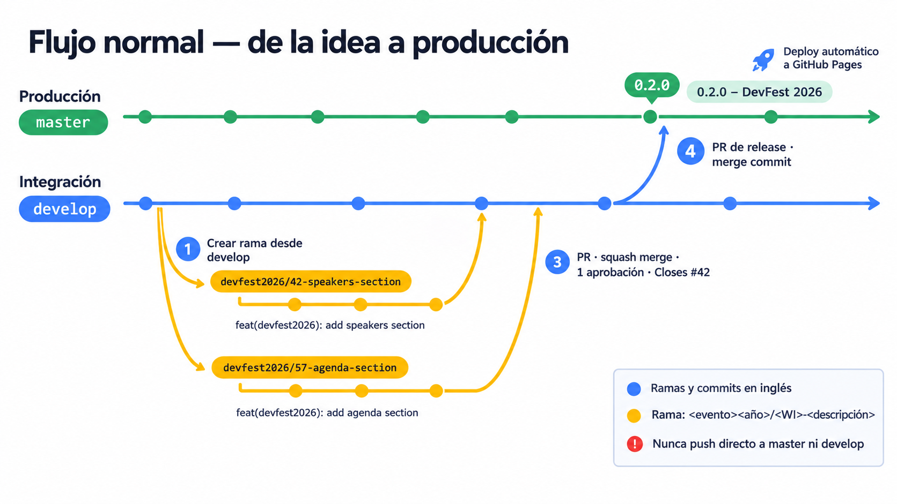
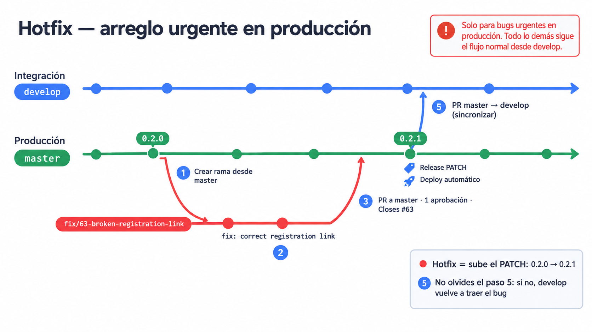

# 🌿 Ramas

## Ramas principales

| Rama | Para qué sirve | Regla |
| --- | --- | --- |
| `master` / `main` | Producción (lo que ve la gente) | Solo se actualiza por PR desde `develop` |
| `develop` / `dev` | Integración del trabajo del equipo | Se actualiza por PR desde tu rama |

> El nombre exacto depende del repo (por ejemplo, la landing usa `master` y `develop`; el back-office usa `dev`). Nunca hagas push directo a estas ramas.

### Flujo normal



### Hotfix

Solo para bugs urgentes en producción. Ver los pasos en [Releases](releases.md#arreglo-urgente-en-producción-hotfix).



## Cómo nombrar tu rama

Toda rama incluye el **número del WI** (el issue de GitHub Projects) y una **descripción corta en inglés**, en `kebab-case`.

### Formato general (todos los repos)

```
<type>/<WI>-<short-description>
```

```bash
git checkout -b feat/42-login-page
git checkout -b fix/57-sponsor-link-redirect
git checkout -b docs/61-update-readme
```

`type` es el mismo que usamos en los [commits](commits.md): `feat`, `fix`, `docs`, `refactor`, `style`, `chore`.

### Landing (`gdg-tarija`): ramas por evento

En la landing trabajamos por evento, así que el prefijo es **el evento**. Así se ve de un vistazo qué ramas pertenecen a cada landing.

```
<event><year>/<WI>-<short-description>
```

Para el **DevFest 2026**:

```bash
git checkout -b devfest2026/42-speakers-section
git checkout -b devfest2026/57-fix-agenda-mobile
git checkout -b devfest2026/63-registration-button
```

El trabajo de la landing que **no es de un evento** (página principal, miembros, etc.) usa el formato general: `feat/70-members-social-links`.

## Tips

- **¿De dónde saco el número del WI?** Del issue en GitHub Projects (`#42`). Si el item es un *draft*, conviértelo primero en issue para que tenga número.
- Puedes crear la rama directo desde el issue: **Development → Create a branch**. Solo ajusta el nombre al formato.
- Crea la rama siempre desde `develop` actualizado:

  ```bash
  git checkout develop && git pull
  git checkout -b devfest2026/42-speakers-section
  ```

- Una rama = un WI. Al hacer merge, borra la rama.

### ✅ / ❌

```
✅ devfest2026/42-speakers-section
✅ fix/57-sponsor-link-redirect
❌ 139-create-swag-section        (falta el tipo o evento)
❌ feat-main-event                (falta el WI y la barra)
❌ devfest2026/agregar-ponentes   (sin WI y en español)
```
